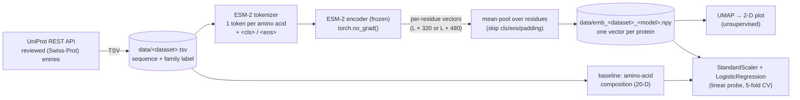
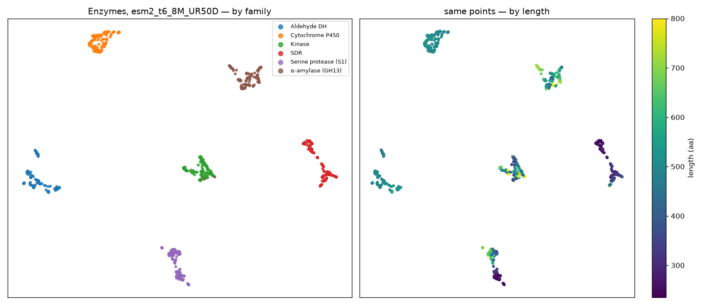
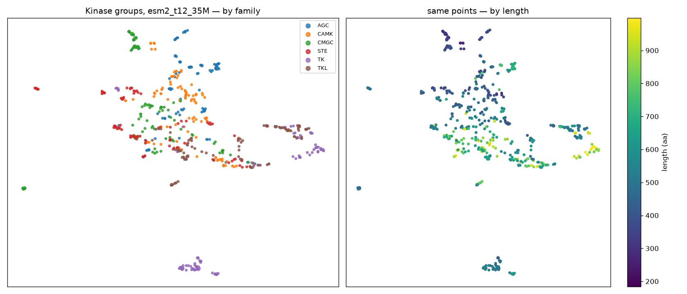

# Protein embeddings with ESM-2: what the notebook does

[`protein_embedding.ipynb`](protein_embedding.ipynb) uses **ESM-2**, a protein language model, as a frozen **feature extractor**. It downloads labeled protein sequences from UniProt and turns each protein into one vector. Then it checks how much those vectors "know" in two ways: by looking at them with **UMAP**, and by training a **logistic regression** on them.

The pattern it teaches is the most common way foundation models are used in practice:

> **frozen pretrained model → fixed-length vectors → small, cheap, classic model**

No model weights are trained or updated anywhere in the notebook.

---

## 1. Pipeline



* **Caching.** Sequences and embeddings are saved under [`data/`](data/). Re-running the notebook skips the download and the slow embedding step. Delete a file to recompute it.
* **Runtime.** Everything runs on CPU (this laptop has no GPU). Embedding 600–720 proteins takes about 2–2.5 min with the 8M model and about 6–7 min with the 35M model.
* **Kernel.** The notebook uses the `glm_test` kernel (Python 3.12, torch 2.2, transformers 4.41, umap-learn, scikit-learn).

---

## 2. Notebook walkthrough

| § | Section | What happens | Concept |
|---|---|---|---|
| 0 | Setup | Imports, picks `MODEL_NAME` (default `facebook/esm2_t6_8M_UR50D`) and the device | Hugging Face checkpoints |
| 1 | Get sequences | Queries UniProt for 120 reviewed proteins in each of 6 enzyme families (≤ 800 aa) | Curated labels, data caching |
| 2 | Load ESM-2 | Loads the tokenizer and model and tokenizes a short sequence to show `<cls> M E S … <eos>`. Prints the output shape `(batch, tokens, hidden_dim)` | Tokens and per-token hidden states |
| 3 | Embed | Runs every sequence through the model in length-sorted batches, then mean-pools the real residues into one vector | **Feature extraction**, pooling |
| 4 | UMAP | 2-D projection colored by family and, separately, by length | What unsupervised structure the model learned |
| 5 | Linear probe | 75/25 split, standardize, logistic regression, classification report and confusion matrix | **Linear probing** |
| 6 | Baseline | Same classifier on amino-acid composition (20-D), compared with 5-fold CV | Always beat a cheap baseline |
| B | Kinase groups | A harder dataset: 100 kinases from each of 6 groups (AGC, CAMK, CMGC, STE, TK, TKL) | Task difficulty |
| 7 | 8M vs 35M | Embeds the kinases with both models and compares accuracy | Model size vs. downstream quality |
| 8 | Errors | Confusion matrix and a list of misclassified kinases | Error analysis |

### Key concepts

* **Why ESM-2 "knows" anything.** It was trained as a masked language model on about 65M protein sequences: hide some amino acids and predict them from the rest. Doing that well forces it to learn conservation, co-varying residues and structural constraints. It never saw a family label.
* **Mean pooling.** The model gives one vector per residue. Averaging them gives a fixed-size vector for proteins of any length. The `<cls>`/`<eos>` tokens and padding are masked out so they don't dilute the average.
* **Linear probe.** A linear classifier on frozen features measures how easy the information is to *read out* of the representation. High accuracy with a linear model means the embedding already separates the classes.
* **Baseline.** Amino-acid composition is a "free" 20-D feature. The gap between it and ESM-2 shows how much the foundation model adds.

---

## 3. Results (from the saved run)

### How the evaluation works

**Inputs to the classifier.** Each protein is one embedding vector: 320 numbers with the 8M model, 480 with the 35M model. For the enzymes, the feature matrix is **720 proteins × 320**, and the label is one of 6 families.

**Train/test sizes.**

| Where | Train | Test | Per family (train / test) |
|---|---|---|---|
| §5 single split (enzymes, 75/25 stratified) | 540 | 180 | 90 / 30 |
| §6–7 5-fold CV, enzymes (720) | 576 | 144 per fold | 96 / 24 |
| §6–7 5-fold CV, kinases (600) | 480 | 120 per fold | 80 / 20 |

Every accuracy reported here is measured on proteins the classifier did not see during training.

**Model size vs. data size.** With 6 classes, the logistic regression has 6 × (320 + 1) = **1,926 parameters** (8M embeddings) or 6 × 481 = 2,886 (35M). That's more than the number of training proteins. Two things keep it from overfitting: scikit-learn's default L2 regularization (`C=1.0`), and the fact that the embeddings are already close to linearly separable.

**The two reference rows.** These are separate experiments that run through the same classifier and the same splits. They are not extra features added to the embeddings.

* **Majority class (chance):** always predict the most common class, computed as `max(value_counts(normalize=True))`. Both datasets are balanced (6 equal classes), so it is 1/6 = 0.167. This is the floor any model must beat.
* **Amino-acid composition:** a 20-D vector holding the fraction of each of the 20 standard amino acids in the sequence (`count(a) / len(seq)`). It captures bulk chemistry, such as hydrophobicity, charge and cysteine content, but it ignores order: shuffling a sequence gives the same vector. The gap between this row and ESM-2 measures what the foundation model adds beyond simple composition.

### Part A: 6 enzyme families (easy)



| Features | Dim | 5-fold CV accuracy |
|---|---|---|
| Majority class (chance) | – | 0.167 |
| Amino-acid composition | 20 | 0.907 ± 0.013 |
| ESM-2 8M | 320 | **1.000 ± 0.000** |

* **§5 held-out test (180 proteins):** precision, recall and F1 are 1.000 for all 6 families, with zero errors.
* The UMAP shows six separate islands even though the model never saw a label. Coloring by length shows the clusters aren't explained by protein size. For example, the P450 and aldehyde dehydrogenase (ALDH) clusters have similar lengths but sit far apart.
* This task is too easy to tell models apart: even the composition baseline reaches 91%. Part A works as a check that the pipeline is correct.

### Part B: 6 kinase groups (harder)



| Features | Dim | 5-fold CV accuracy |
|---|---|---|
| Majority class (chance) | – | 0.167 |
| Amino-acid composition | 20 | 0.638 ± 0.055 |
| ESM-2 8M | 320 | 0.953 ± 0.011 |
| ESM-2 35M | 480 | **0.968 ± 0.022** |

* Every kinase shares the same catalytic fold, so composition alone drops to 64%. ESM-2 still reaches about 95–97%. This is where the foundation model clearly earns its place.
* The 35M model is slightly better than the 8M model, but the gap is within the error bars. Going bigger has diminishing returns on this task.
* In the UMAP, TK (tyrosine kinases) and CMGC form well-separated clusters, while AGC and CAMK overlap in the middle.
**Errors (35M model, 5-fold CV predictions):** 19 of 600 kinases are misclassified (96.8% correct).

| True ↓ / Predicted → | AGC | CAMK | CMGC | STE | TK | TKL |
|---|---|---|---|---|---|---|
| **AGC** | **95** | 4 | 0 | 1 | 0 | 0 |
| **CAMK** | 3 | **94** | 0 | 3 | 0 | 0 |
| **CMGC** | 0 | 0 | **100** | 0 | 0 | 0 |
| **STE** | 0 | 0 | 1 | **94** | 0 | 5 |
| **TK** | 0 | 0 | 0 | 0 | **99** | 1 |
| **TKL** | 0 | 0 | 0 | 1 | 0 | **99** |

* **STE → TKL (5)** is the largest error. Most of these are human **MAP3Ks**, which sit near the TKL branch of the kinome tree.
* **AGC ↔ CAMK (7 in total)** is the next most common error. These two groups are close relatives, and they overlap in the middle of the UMAP.
* **CMGC is perfect** and **TK misses only one protein**, which matches their tight, well-separated UMAP clusters.

---

## 4. Conclusions

1. **The "foundation model as feature extractor" pattern works.** A model pretrained only to fill in masked amino acids, with no labels, produces vectors that a simple linear classifier can turn into 95–100% accurate family predictions. Nothing was trained except a logistic regression that fits in under a second.
2. **The label structure is already in the embeddings.** UMAP is unsupervised and still recovers the families (clearly for enzymes, partly for kinase groups). The pretraining objective made the model organize proteins by evolutionary and functional relationships.
3. **Baselines show what the model is worth.** On the easy task, the 20-number composition baseline gets 91%, so ESM-2 adds little. On the hard task, composition falls to 64% while ESM-2 stays near 96%, a gap of more than 30 points. The model earns its keep where differences depend on residue order and context, not bulk chemistry.
4. **A bigger model gave only a small improvement here.** Going from 8M to 35M parameters (4× the size, about 3× slower on CPU) moved kinase accuracy from 95.3% to 96.8%, within the error bars. For a quick feature extractor on a laptop, the 8M model is a sensible default. Try a bigger one when the task is hard and the baseline gap matters.
5. **Errors follow biology.** The misclassifications fall between kinase groups that are close relatives (STE/TKL, AGC/CAMK), not at random. The embedding space reflects real evolutionary distance.
6. **The numbers are likely optimistic.** A random split lets close homologs appear in both train and test (see caveats). Treat these accuracies as an upper bound until a homology-aware split confirms them.

---

## 5. Caveats

* **Optimistic splits.** UniProt holds many orthologs (the same protein in human, mouse, cow, …), and a random split can put near-identical sequences in both train and test. A homology-aware split (cluster at ~30% identity, e.g. with MMseqs2, and split by cluster) would give lower and more honest numbers.
* **Sampling bias.** The UniProt search returns the top *N* hits by relevance score, so the sample leans toward well-studied organisms (lots of human, yeast and worm). It is not a random draw from each family.
* **Sequences are capped** at 800 aa (enzymes) and 1000 aa (kinases) to keep CPU time down. ESM-2 itself can take up to 1022 residues.

---

## 6. Things to try next

1. **Probe each layer.** Pass `output_hidden_states=True` and run the probe on every layer. Middle layers are often as good as the last one, or better.
2. **Go bigger.** Add `facebook/esm2_t30_150M_UR50D` (640-D) to `MODELS` in §7.
3. **Homology-aware split** (see caveats). See how much the accuracy drops.
4. **New labels.** Try the first digit of the EC number, subcellular location, or organism kingdom.
5. **Fine-tune.** Unfreeze ESM-2 and train it end-to-end on the kinase task. Compare the accuracy gain against the extra compute. That is the main trade-off between feature extraction and fine-tuning.

---

## 7. Files

```
protein_embedding/
├── protein_embedding.ipynb   # the notebook (saved with outputs)
├── README.md                 # this file
├── data/                     # cached sequences (.tsv) and embeddings (.npy)
└── figs/                     # UMAP plots used above
```
